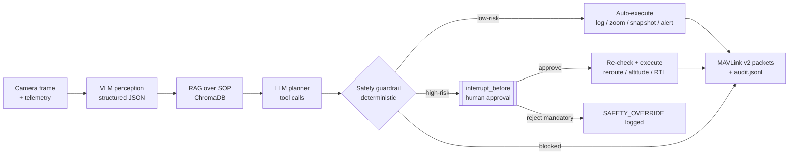

# SkyGuard: Aerial VLM & Autonomous Mission Agent

SkyGuard is an end-to-end, open-source agent for drone security and inspection. It feeds a camera frame and live telemetry to a vision-language model, checks the site SOP and flight rules through RAG, plans actions with tool calls, and passes every plan through a **deterministic safety guardrail**. Low-risk actions run on their own. High-risk actions pause the LangGraph run until a human approves them in a Streamlit console. Every command is emitted as a **real MAVLink v2 packet** and written to an audit trail.

The whole stack is free. It runs **fully offline** with no API keys, and **one free Groq key** switches on the real VLM and LLM.



## Tech stack

| Layer | Tool | Notes |
|---|---|---|
| Orchestration | **LangGraph** | `StateGraph`, `InMemorySaver` checkpointer, `interrupt_before=["execute_high_risk"]`, `update_state` + resume |
| Vision-language model | **Llama-4-Scout on Groq** (default) · **Qwen2.5-VL-3B-Instruct 4-bit** (local, fits a 4 GB GPU) · HF Inference · mock | All backends share one prompt and one Pydantic-validated JSON schema |
| Reasoning LLM | **Llama-3.3-70B on Groq** · Ollama · deterministic SOP playbook | Native parallel tool calling; the rules planner is the offline default and the fallback when the LLM fails |
| Vector DB | **ChromaDB** (local, persistent) · BM25 fallback | One numbered SOP clause per chunk, so every decision cites e.g. `SOP-SUB-B-v1.3 §6.2` |
| Drone | **Python drone simulator** + **pymavlink** | GPS, altitude, battery drain under wind, flight modes, frame queue; byte-exact `COMMAND_LONG` / `COMMAND_INT` / `STATUSTEXT` |
| Observability | **LangSmith** (free tier) or **Arize Phoenix** (local) + JSONL audit trail | Per-node timings in graph state |
| UI | **Streamlit** | Approve, reject or edit each high-risk action; live map, MAVLink hex, audit trail |

## Quickstart

```bash
git clone https://github.com/Kshitiz0809/skyguard-aerial-agent.git
cd skyguard-aerial-agent
python -m venv .venv
# Windows: .venv\Scripts\activate    macOS/Linux: source .venv/bin/activate
pip install -r requirements.txt
cp .env.example .env                 # optional: add GROQ_API_KEY
python scripts/generate_samples.py   # synthetic aerial frames + ground truth (already committed)
streamlit run app.py
```

Headless run with a terminal approval prompt:

```bash
python -m skyguard.cli --scenario substation_intruder
python -m skyguard.cli --scenario low_battery_intruder --auto reject   # shows a SAFETY_OVERRIDE
python -m skyguard.cli --scenario high_wind_hv_lines --vlm groq --llm groq
```

Tests (fully offline, about 6 s):

```bash
pytest -q
```

## Scenarios

| Scenario | Telemetry | What happens |
|---|---|---|
| `substation_intruder` | battery 64%, wind 9 kt | VLM flags `unauthorized_vehicle_near_fence`. The agent logs it, zooms to 4x, takes a snapshot and alerts security on its own. The standoff **reroute pauses for approval**. |
| `low_battery_intruder` | **battery 18%** | Guardrail cites §6.2: **RTL is mandatory**, any reroute is cancelled, and rejecting the RTL is logged as `SAFETY_OVERRIDE`. |
| `high_wind_hv_lines` | **wind 27 kt**, near 220 kV lines | The wind limit (§6.3) forces RTL. Altitude floors rise to 30 m. |
| `solar_farm_hotspot` | battery 71% | Low-risk only: log and snapshot, no human needed, and the run completes without an interrupt. |

Every scenario's telemetry (battery, wind, altitude, HV proximity) can be changed live from the sidebar. You can also upload any aerial image, or pull real **VisDrone** frames with `python scripts/download_visdrone.py`.

## Design decisions

- **The LLM proposes and code decides.** The guardrail in [skyguard/safety/guardrails.py](skyguard/safety/guardrails.py) is plain Python that mirrors SOP clauses: the battery RTL threshold, the wind abort limit, the 15 m floor near HV lines (30 m in gusts), the 120 m ceiling, the geofence and argument validation. A hallucinated tool call cannot fly the drone below a power line.
- **Approvals are re-checked.** If the operator edits a reroute in the UI, the edited arguments go through the guardrail again before execution. If the guardrail injects an action during that re-check, it never runs without approval.
- **Mandatory actions are not dropped.** If the battery is critical and the LLM forgets the RTL, the guardrail injects one. Rejecting it is allowed (the human keeps authority) but is logged as `SAFETY_OVERRIDE` for review.
- **Graceful degradation.** If the VLM call fails, perception falls back to the mock and flags it. If the LLM call fails, planning falls back to the SOP playbook. The safety loop never stalls on an API error.
- **Real MAVLink.** The packets are byte-exact MAVLink v2 frames (`0xFD` start byte) that round-trip through the pymavlink parser. Send `EncodedCommand.raw` to `udp:127.0.0.1:14550` to drive PX4 or ArduPilot SITL.

## Optional backends

**Groq (recommended):** create a free key at https://console.groq.com/keys and set `GROQ_API_KEY` in `.env`. This turns on both the VLM and the 70B planner.

**Local Qwen2.5-VL-3B (4-bit, 4 GB GPU):**
```bash
pip install torch torchvision --index-url https://download.pytorch.org/whl/cu130   # CUDA build (~2.5 GB)
pip install -r requirements-gpu.txt     # transformers + accelerate + bitsandbytes
# first run downloads the model weights (~7.5 GB) from Hugging Face
python -m skyguard.cli --vlm qwen_local
```
`max_pixels` is capped at 640×28×28 to keep peak VRAM around 3.2 GB.

**Ollama (local LLM):** `pip install langchain-ollama`, `ollama pull qwen2.5:7b`, then `LLM_PROVIDER=ollama`.

**Tracing:** set `LANGSMITH_TRACING=true` and `LANGSMITH_API_KEY` (free at https://smith.langchain.com). Every graph run then shows up as a trace tagged with its scenario. For a local alternative, install `requirements-optional.txt`, run `phoenix serve`, and set `PHOENIX_ENABLED=true`.

## Project layout

```
app.py                      Streamlit operator console (HITL)
skyguard/
  agent/graph.py            LangGraph mission loop, interrupt + resume
  agent/planner.py          Groq / Ollama tool calling + SOP rules planner
  perception/vlm.py         Groq / Qwen-local / HF / mock VLM backends
  perception/schema.py      Prompt + Pydantic output contract
  rag/policy_store.py       ChromaDB clause-level RAG (+ BM25 fallback)
  safety/guardrails.py      Deterministic safety envelope with SOP citations
  simulator/drone.py        Drone state simulator
  simulator/mavlink.py      MAVLink v2 encoding (pymavlink)
  tools/actions.py          Tool registry, risk classes, executors
  observability.py          LangSmith / Phoenix setup, JSONL audit log
data/sop/                   Dummy site SOP + flight-manual summary (RAG corpus)
data/samples/               Synthetic aerial frames + ground-truth JSON
tests/                      19 offline tests (unit, graph HITL, Streamlit AppTest)
```

## Disclaimer

The SOP and regulatory documents in `data/sop/` are **fictional demo material**. They are not an official DGCA publication or any real operator's procedure. This is a research and portfolio project, not certified flight software.
